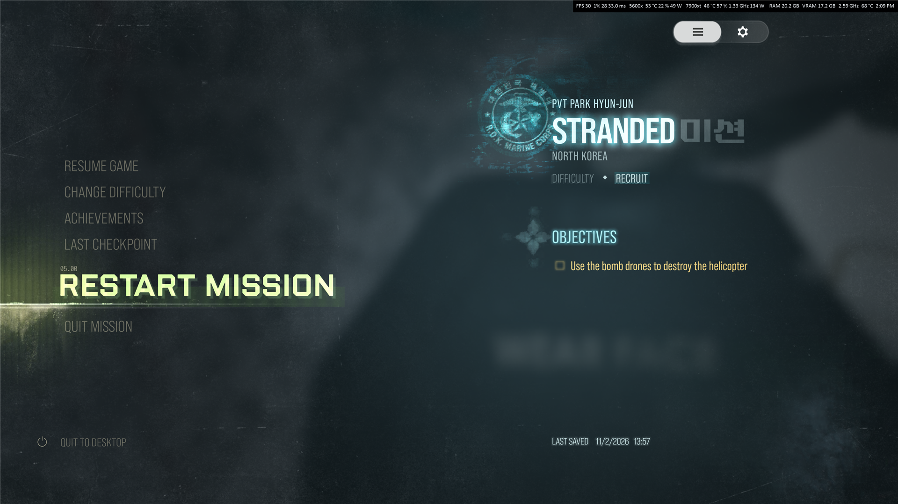
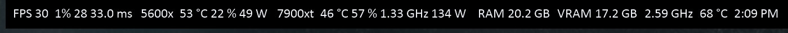
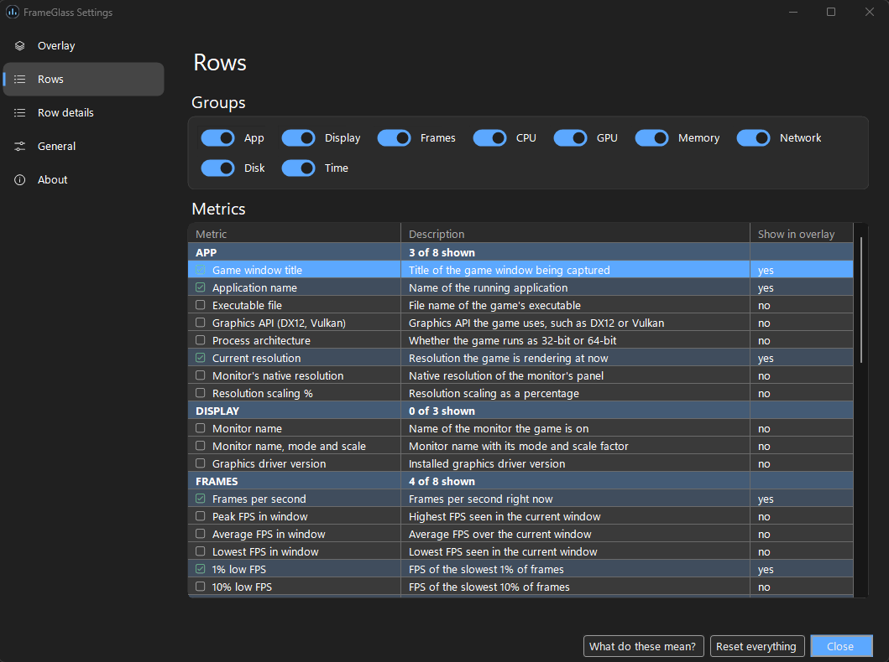
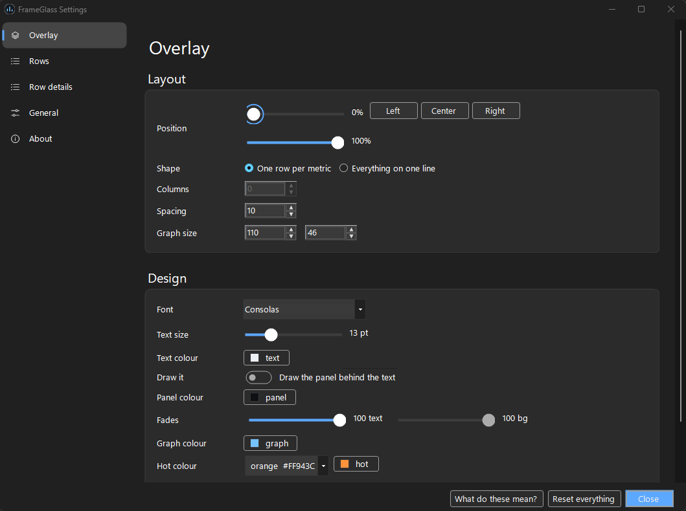
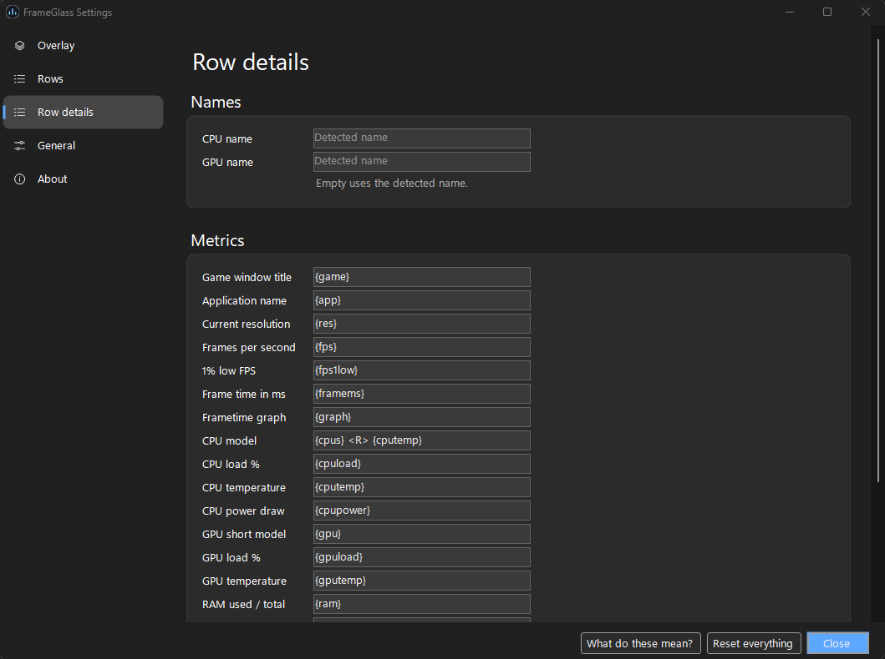
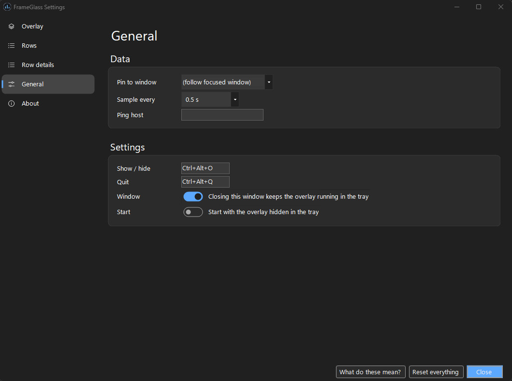

# FrameGlass

**See your frame rate, temperatures and system load while you play. Free, no account, nothing sent anywhere.**

[](LICENSE)
[](#what-you-need)
[](#privacy)

FrameGlass is a small overlay in the spirit of RivaTuner and Afterburner. It sits on top of your game, on the
same monitor, and you choose exactly what it shows.



*A real capture from Call of Duty: Modern Warfare 4. The bar is in the top right corner.*



## Tested on real games

I have played these with FrameGlass running:

- Call of Duty: Modern Warfare 4
- Silent Hill f
- Silent Hill: Townfall
- Need for Speed Unbound

**Test PC:** Windows 11 Pro 25H2, AMD Ryzen 5 5600X, AMD Radeon RX 7900 XT, 32 GB RAM, with 1080p and 4K monitors.

Windows 10 should work but has not been tested. Neither have Intel or NVIDIA hardware.

## How much it uses

Measured on the test PC over 2 minutes with Modern Warfare 4 running. Your numbers may differ.

| | |
|---|---|
| **CPU** | About 0.4% on average, 1.9% at peak |
| **Memory** | About 200 MB |
| **Graphics card** | Nothing measurable (0% in a single reading) |
| **Download** | About 48 MB |
| **Disk space** | About 50 MB |

## What it shows

- **Frame rate:** FPS, average, peak, lows, frame time and a live graph
- **CPU:** load, temperature, clock speed, power and fan
- **Graphics card:** load, temperature, clock speed, power, fan and video memory
- **Memory:** RAM used and total
- **Game and display:** game name, resolution, monitor and refresh rate
- **Network and disk:** upload, download, ping, and disk read and write speeds

Turn on only what you want. Layout, colours, fonts and position are all yours to change.

## What you need

- Windows 10 or 11, 64-bit
- Administrator permission, which Windows asks for each time it starts. Temperatures and frame times can't be read
  without it.

There's nothing else to install.

## Install

1. Download `FrameGlass-v1.0.0-win-x64.zip` from the [latest release](https://github.com/anshusangita08/FrameGlass/releases/latest).
2. Extract the whole folder and keep the files together.
3. Run `FrameGlass.exe` and accept the Windows prompt.

The app isn't code signed, so Windows SmartScreen may warn you the first time.

## Using it

- **Show or hide the overlay:** press `Ctrl+Alt+O`, or click the tray icon.
- **Quit:** press `Ctrl+Alt+Q`, or right-click the tray icon.
- **Change settings:** edits show on the overlay straight away, with no Save button. Closing the settings window keeps
  the overlay running in the tray.
- **Follow one game:** by default the overlay follows whichever window is focused. To keep it on one game, pick that
  game on the General page.



<details>
<summary>More screenshots</summary>







</details>

Want to reword rows or add colours? See [Customising rows](docs/customising.md).

## Privacy

- No telemetry, accounts, analytics or crash reports.
- The only network traffic is an optional ping to a host you choose. Leave it empty and FrameGlass stays offline.
- It only writes its settings file and a small log, both next to the app.

## Good to know

- **Frame generation:** with it on, FrameGlass shows the generated frame rate, not the rate the game actually renders.
- **Exclusive fullscreen:** a game in true exclusive fullscreen covers the overlay. Use borderless or windowed mode. If
  it's still hidden, turn on *Windowed Games Optimizations* in Windows under Settings > System > Display > Graphics.
- **Upscalers:** FrameGlass can't tell which upscaler or frame generation mode a game is using, so it doesn't guess.
- **Graphics card figures:** these cover the whole card, not just your game.

## Build it yourself

With the [.NET 10 SDK](https://dotnet.microsoft.com/download/dotnet/10.0) installed:

```powershell
git clone https://github.com/anshusangita08/FrameGlass.git
cd FrameGlass
dotnet publish FrameGlass.csproj -c Release -o dist
```

## Licence

MIT, see [LICENSE](LICENSE). Free to use, change and share.

**by anshusangita08** · [issues and feature requests](https://github.com/anshusangita08/FrameGlass/issues)
